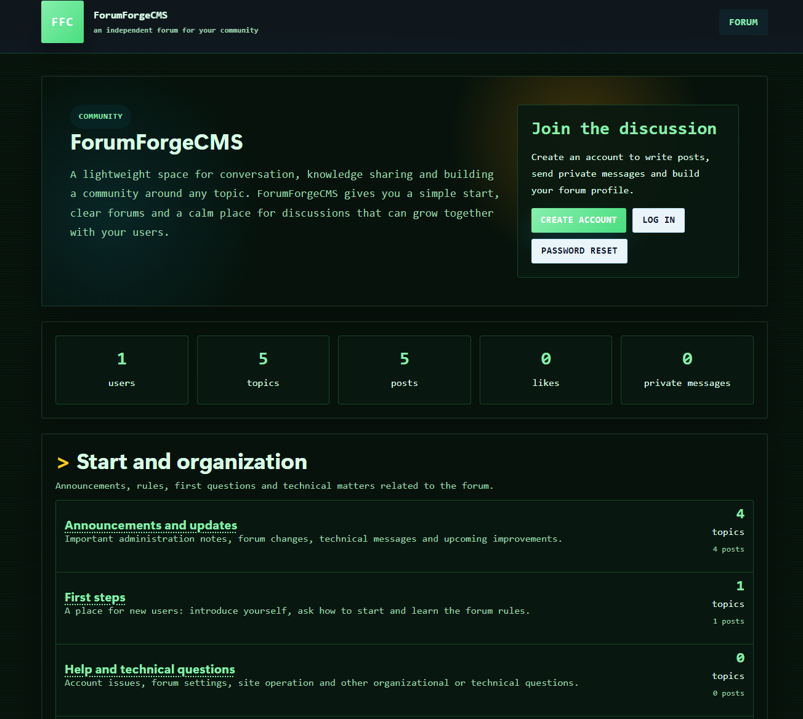
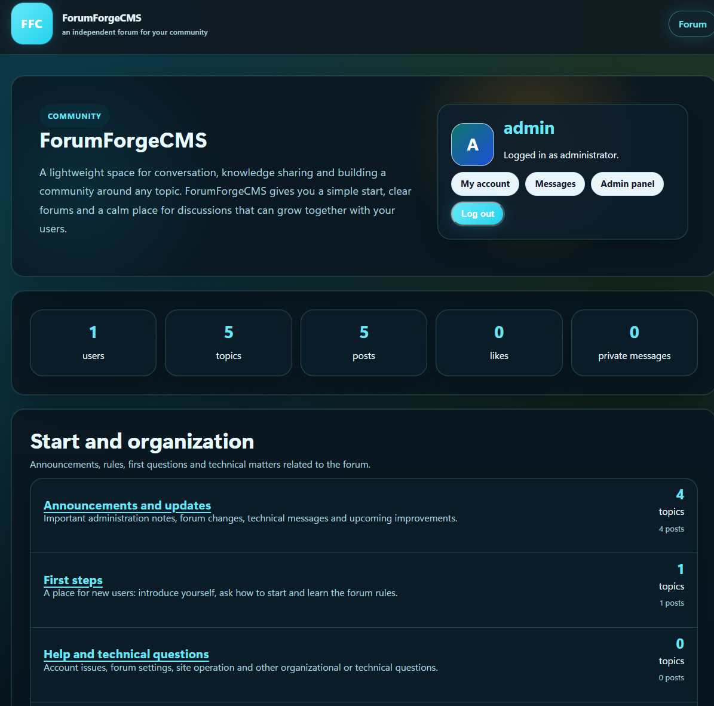
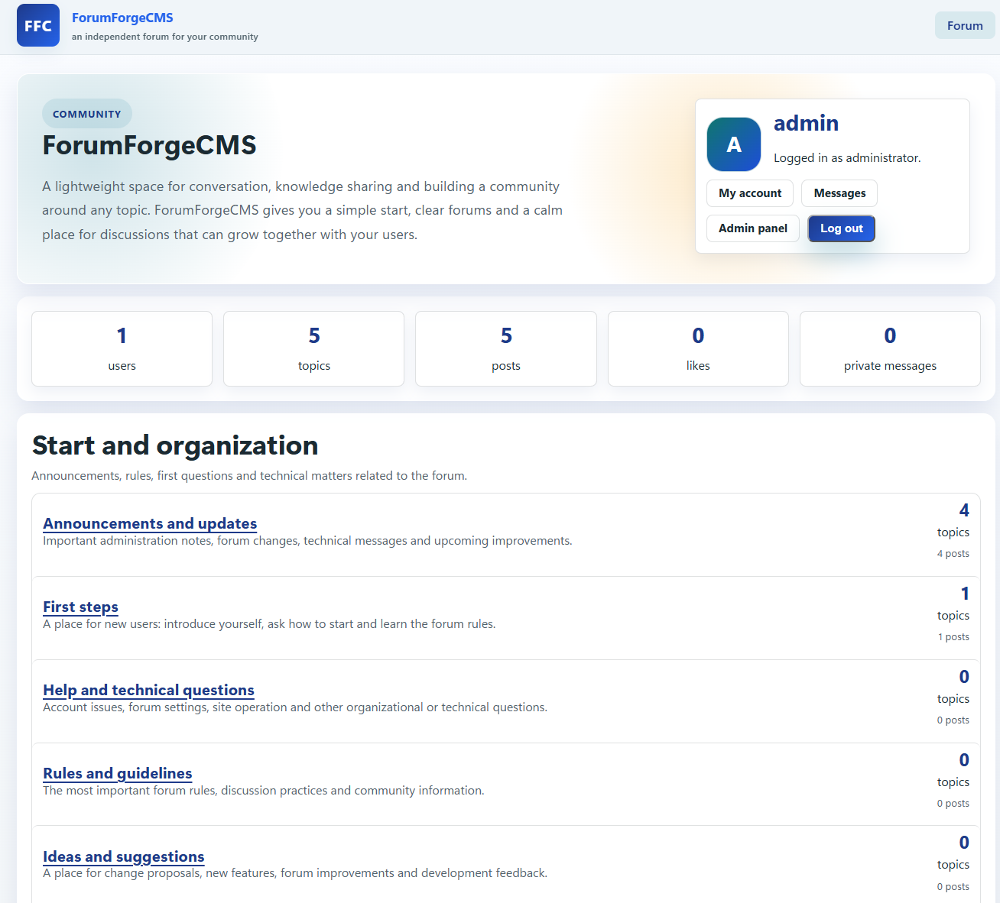
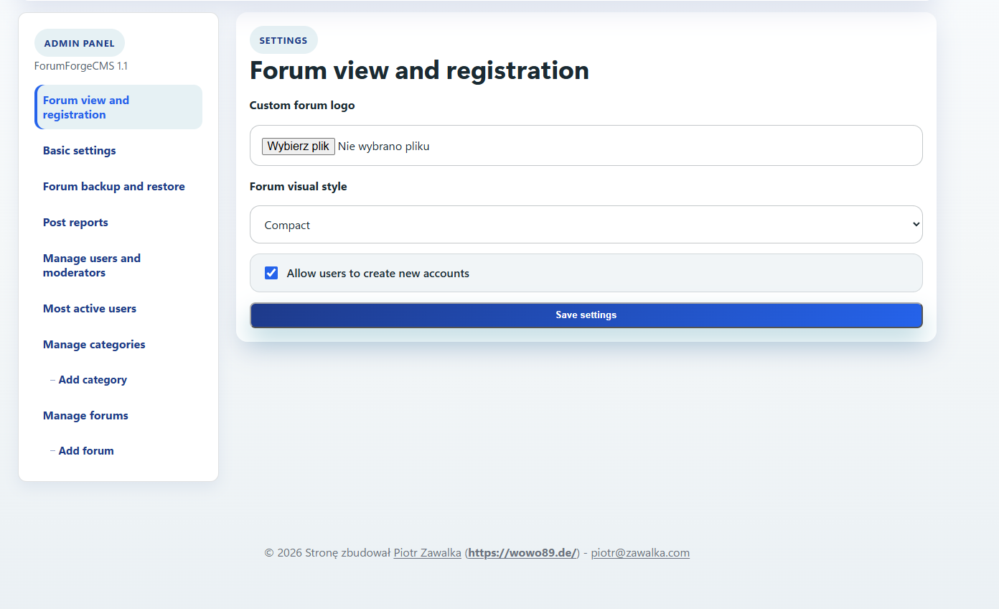
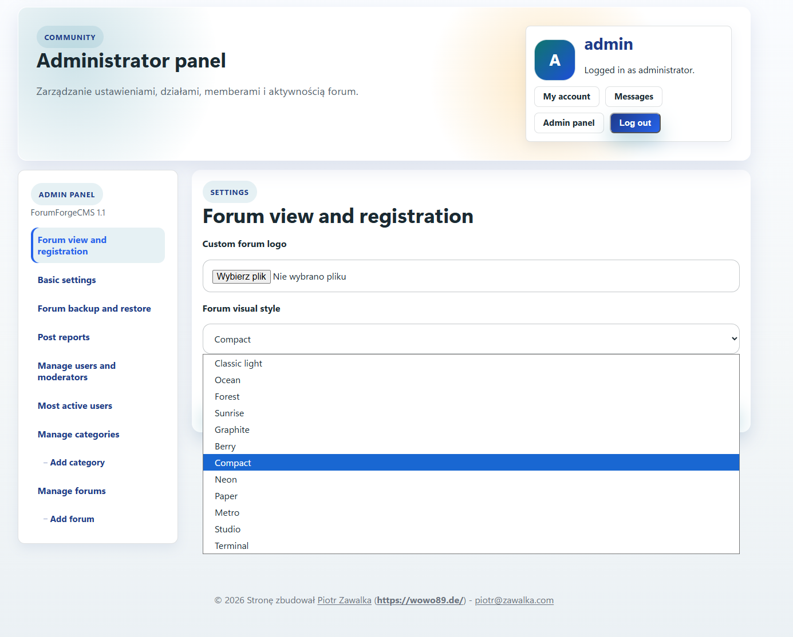
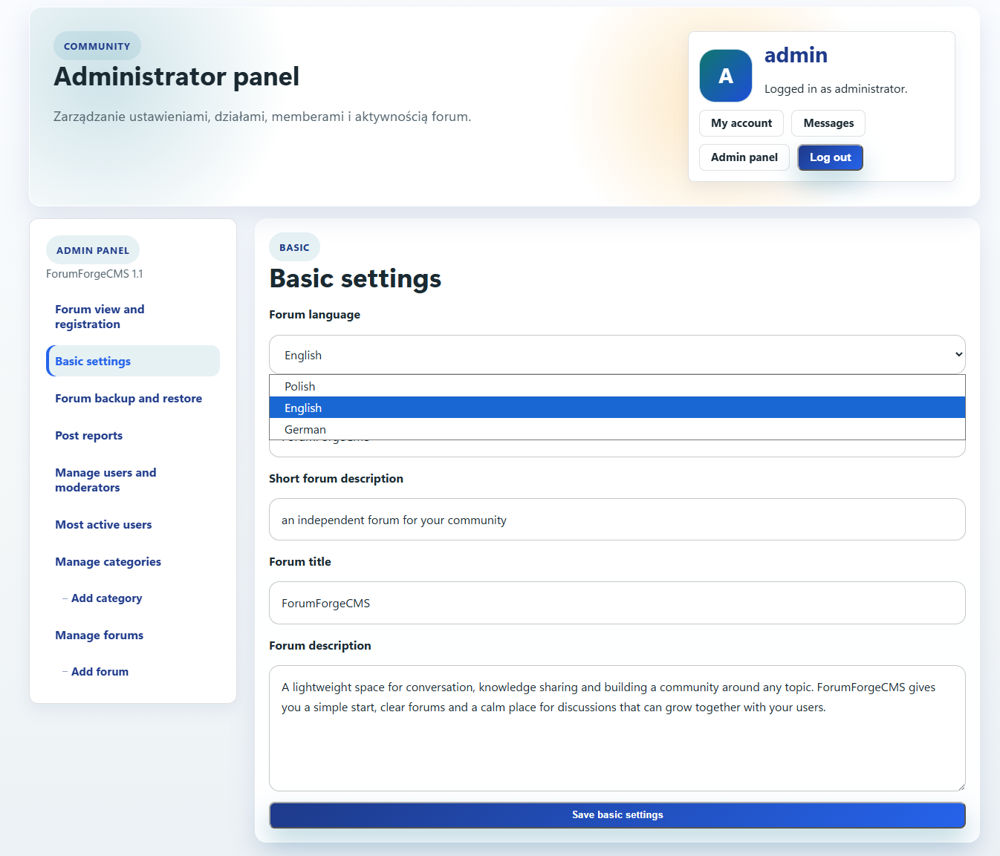
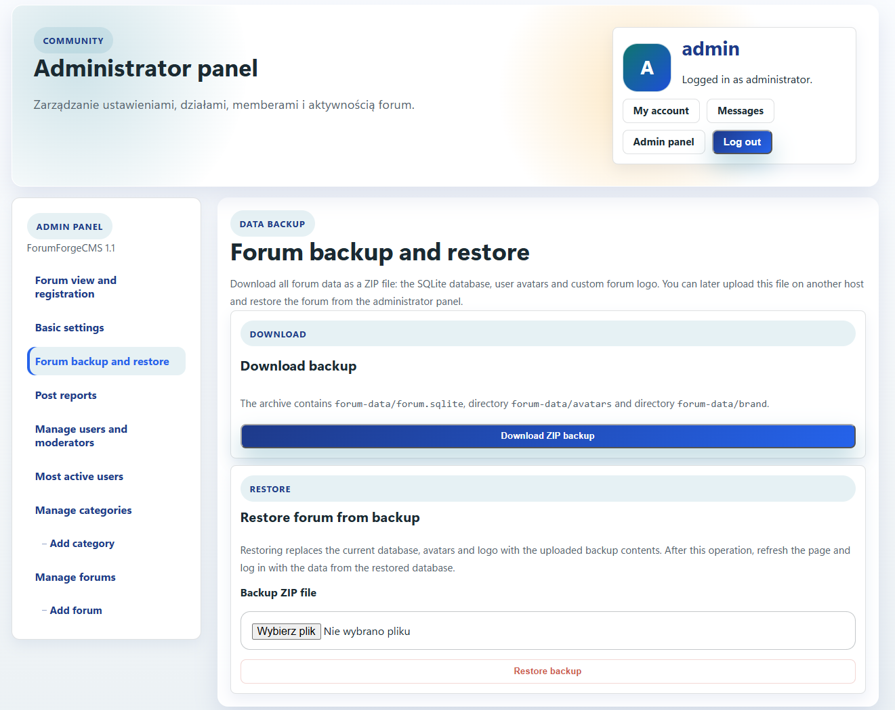

# ForumForgeCMS

ForumForgeCMS is a lightweight, self-hosted forum CMS built for classic PHP hosting environments. It is designed to run as a standalone website without a build pipeline, external services, or a dedicated database server. Upload the files, open the forum in a browser, and the system initializes itself with SQLite, a default administrator account, starter categories, and a clean administration panel.

The project focuses on practical deployment, readable moderation workflows, and a complete forum experience that can be hosted on standard web hosting packages such as Strato-style PHP hosting.

Current release: **ForumForgeCMS 1.5**

[Download version 1.5](https://github.com/wowo220689/ForumForgeCMS/releases/tag/v1.5) | [Release notes](RELEASE-NOTES-1.5.md) | [Changelog](CHANGELOG.md)

## Live Demo

Try ForumForgeCMS online:

[https://wowo89.de/forge](https://wowo89.de/forge)

## Key Features

- Standalone PHP forum CMS with SQLite storage
- Automatic first-run installation
- Default administrator account created as `admin`
- Generated initial administrator password stored in `forum-data/admin-initial-password.txt`
- Category and forum management from the admin panel
- User registration, login, password reset, avatars, profiles, and private messages
- Moderator role with post reports and moderation workflow
- Topics, replies, likes, pinned topics, locked topics, quotes, reports, and edit notes
- Rich post editor with formatting tools and an emoticon picker
- Built-in forum search for topics and posts with excerpts, forum names, result limits, and pagination
- Client-side image resizing and WebP conversion for avatars and forum logos
- Configurable forum name, description, logo, language, registration, and visual style
- Multiple visual themes with different layouts and presentation styles
- Multilingual interface support for English, Polish, and German
- Explicit UTF-8 language dictionaries for interface labels, validation, editor prompts, and system emails
- Administrator-controlled registration question, blocked email domains, usernames, and IPv4/IPv6 addresses
- Persistent login lockouts stored in SQLite, independent of browser sessions
- Forum visibility rules and a separate read-only setting
- On-site notifications for topic replies, private messages, and post reports
- Public profiles with about-me text, location, website, and a plain-text post signature
- Administrator backup and restore tools for the SQLite database, avatars, and custom forum logo
- Visible ForumForgeCMS version information in the administrator panel
- Hosting diagnostics with a safe, browser-based HTTP protection test
- Administrator-accessible maintenance mode with HTTP 503 for visitors
- Public-topic descriptions, Open Graph metadata, and configured canonical URLs
- Password-confirmed self-service account deletion with anonymous discussion retention
- Date-filtered administrator activity statistics for new accounts, topics, and posts
- Basic SQLite performance settings and indexes for small to medium communities
- Protective files for `forum-data` on common Apache/IIS hosting setups

## Screenshots

### Forum Experience







### Administrator Panel









## What's New in 1.5

Version 1.5 adds practical site-operation tools without introducing external services, analytics providers, or a production build step. All new interface text is available in English, Polish, and German.

### Hosting Diagnostics

The new **Hosting diagnostics** administrator page checks PHP 8.1+, PDO SQLite, sessions, database quick integrity, foreign-key enforcement, writable data/image directories, availability of PHP `mail()`, and the presence of Apache/IIS protection files. The mail check does not send email or claim that delivery succeeds; the existing transport remains unchanged.

The HTTP protection test creates a random, non-sensitive text file inside `forum-data/` and requests it from the administrator's browser on the same origin. HTTP 403/404 is reported as a blocked probe, HTTP success triggers a warning, and other outcomes are inconclusive. The test never fetches the live database or password file. Temporary probes are removed after the check; abandoned probes expire and are cleaned during subsequent checks.

This is a diagnostic aid, not a complete security audit. Rules may treat extensions differently: separately verify protection of the SQLite database, generated password, and SQLite WAL/SHM files. Apache/IIS configuration files must actually be enforced. Nginx requires its own server-side deny rule. The PHP development server does not enforce `.htaccess` and will correctly trigger a warning.

### Maintenance Mode

Enable **Maintenance mode** from the administrator menu. Administrators retain normal access; other visitors, including signed-in moderators, receive HTTP 503 with `Retry-After: 3600`, no-store caching, and noindex directives. Avatar and logo endpoints are also gated. The sign-in page remains available so an administrator can sign back in. Only sign-in/sign-out submissions bypass the maintenance gate, not arbitrary actions sent through the login URL.

Use the translated default message or enter up to 1,000 characters of plain text. Custom messages are escaped and preserved as authored, not automatically translated. Disable maintenance from the same panel when finished. Existing static assets and the site's static terms document are not access-controlled by this application-level mode.

### SEO And Sharing

In **SEO and sharing**, set the full public forum address, for example `https://example.com/forum`, without `index.php`. Public home, forum and topic pages then receive canonical URLs and Open Graph URLs. Canonicals preserve valid topic/forum pagination while omitting quote, edit, token and tracking parameters. The origin comes only from this administrator-controlled setting, never from an untrusted request Host header.

Public topics use a plain-text excerpt of their first post. Open Graph metadata includes the forum name, localized locale, title, description, content type, and the custom logo when configured. Restricted forums and account, search, authentication, moderation and administration pages are marked noindex; restricted post text is not included in sharing metadata. Setting a URL is optional: leaving it empty omits absolute canonicals and Open Graph links. Search engines and social platforms ultimately decide how and when to display these signals.

### Account Deletion

Members and moderators can permanently delete their own account from **My account** after entering their current password and explicitly accepting the retention policy. The server ignores a submitted target-user ID and operates only on the signed-in account. Administrator accounts are protected from self-service deletion.

Deletion removes the real user row, login/email, public profile fields, avatar, private messages involving the account, its likes, submitted reports, reset tokens and notifications. Sessions tied to the removed user can no longer authenticate. Topics and posts are transferred to a shared, non-login anonymous account (`[deleted]`) so other participants' replies remain intact. That account has no public profile and is excluded from member counts, rankings and new-account statistics.

This is account removal, not automatic redaction of every mention of a person. Post text, quotes, other users' content and already-created backups can still contain personal information. The confirmation form explains this limitation before deletion; users should contact the administrator about such content first. Backup retention and removal requests remain the site operator's responsibility.

### Activity Statistics

The administrator-only **Activity statistics** page shows new accounts, topics and posts for an inclusive date range, with totals and a daily table. The default is the last 30 calendar days; a range may span at most 366 days. Dates use Europe/Berlin time, including daylight-saving transitions. Indexed SQLite date queries and streamed aggregation avoid loading complete content records.

These are counts of currently retained database records, not visitor analytics or an immutable audit log. Deleting records changes past totals. No visitor-tracking cookies or external analytics requests are added.

Version 1.5 is a clean-install release. No migration from previous database schemas is supplied. Use backups created by the same release; after restoring on another host, review **SEO and sharing**, maintenance mode and existing IP blocks before opening the forum to visitors.

## What's New in 1.4

### Persistent Login Protection

Login protection now uses atomic SQLite reservations instead of relying on a browser session. It applies a 15-minute lockout after eight failed attempts against an account or thirty failed attempts from an IP within the protection window. Starting a new session does not reset the counters. Username and email sign-in share the same account counter. Successful authentication clears account failures; a completed password reset also clears the account lock. IP-wide failures remain independent.

Only hashed account/IP keys and counters are stored. As with IP block lists, checks use the server-provided `REMOTE_ADDR`. Configure trusted real-IP handling on the web server when using a reverse proxy. Other existing action limits remain session-based.

### Forum Permissions

Administrators can choose visibility when creating or editing a forum:

| Visibility | Guests | Members | Moderators | Administrators |
| --- | --- | --- | --- | --- |
| Public | Yes | Yes | Yes | Yes |
| Members only | No | Yes | Yes | Yes |
| Moderators and administrators | No | No | Yes | Yes |
| Hidden | No | No | No | Yes |

Read-only is a separate option: members cannot create topics, reply, or edit posts in that forum. Moderators and administrators retain writing/moderation access where the visibility rule allows it. Likes and reports remain available to signed-in users who can read the content.

Permissions are enforced server-side and filter direct URLs, search results, recent activity, public profile activity, content counters, reports, and notifications. Restricted content is not merely hidden with CSS. Public forums remain the default for new installations.

### On-Site Notifications

The account area now includes a notification inbox with an unread badge, twenty entries per page, individual opening, and a mark-all-read action. New replies notify the topic author and earlier participants, excluding the reply author. Private messages notify the recipient. Post reports notify eligible moderators and administrators, and closing a report removes its report notifications for everyone.

Notification access is checked again when listing or opening an entry. Role changes, restricted forums, deleted messages, and closed reports are respected. Reply notifications link to the correct post and topic page. This release adds on-site notifications, not email or push subscriptions.

### Extended Profiles

Members can edit their public profile from **My account**. Administrators can moderate these fields from the user's administration page. Available fields are about me (2,000 characters), location (100), website (255), and signature (300). Signatures appear below the author's posts.

Profile text and signatures are plain text with HTML escaping. Website links must use HTTP or HTTPS, cannot contain login credentials, and are marked as user-generated external links. New labels, validation messages, and notification text are available in English, Polish, and German.

Version 1.4 is a clean-install release. No migration from an older database schema is included; backups from earlier schemas are not supported by this installation workflow. Backups made by 1.4 include the new profile, permission, notification, and login-protection data.

## What's New in 1.3

Version 1.3 introduces a dedicated **Spam protection** page in the administrator panel and replaces output-wide HTML translation with explicit English, Polish, and German dictionaries. Interface translation no longer changes words inside user posts, names, or custom descriptions. Unmodified starter content continues to follow the selected forum language.

### Spam Protection

- A server-validated arithmetic question is enabled on registration by default. Each session-bound question expires after 10 minutes and can only be used once.
- Email domain blocks include the specified domain and its subdomains. Use one domain per line, without `@`, URLs, or wildcards. Internationalized domains must use their ASCII/Punycode spelling.
- Username blocks are exact and case-insensitive, using the same character rules as registration. They prevent new registrations; they do not suspend existing accounts.
- IP blocks accept individual IPv4 or IPv6 addresses and deny access to the forum and its image endpoints with HTTP 403. CIDR ranges are not supported.
- All lists are validated before saving, with a maximum of 1,000 entries per list. The primary administrator name and the administrator's current IP cannot be added to a block list.

The question and lists are lightweight defenses, not a replacement for stronger anti-bot services or web-server controls. Existing rate limits and CSRF protection remain in place. IP checks use the server-provided `REMOTE_ADDR`, not untrusted forwarding headers. When hosting behind a reverse proxy, configure the web server to supply the real client address before using IP blocks; otherwise a shared proxy address could block multiple visitors.

For accidental lockout after an IP change, use trusted hosting/database access to clear the `antispam_ips` value in the SQLite `settings` table. Backups include these settings, so review IP blocks before moving to another host.

### Localization

Translations are stored in `locales/en.php`, `locales/pl.php`, and `locales/de.php`, with named placeholders for dynamic values. JavaScript receives only the interface messages it needs. Browser-native file chooser labels follow the visitor's browser/OS language; user-authored content and the site owner's static terms document are not machine-translated.

Release archives are prepared for clean installation and do not include a live database, administrator password, private credentials, or development tests. No database migration procedure is supplied.

## Requirements

- PHP 8.1 or newer recommended
- PDO SQLite enabled
- Writable `forum-data/` directory
- Standard PHP sessions enabled
- Web server access to `index.php`

No Node.js, Composer, MySQL, PostgreSQL, Redis, or external mail library is required for the base forum.

## Installation

1. Upload all project files to your web hosting directory.
2. Make sure `forum-data/` is writable by PHP.
3. Open `index.php` in your browser.
4. The forum initializes automatically.
5. Log in with the default administrator username:

   ```text
   admin
   ```

6. Read the generated first password from:

   ```text
   forum-data/admin-initial-password.txt
   ```

7. After logging in, change the administrator password and complete the administrator profile.
8. Verify that these URLs are blocked by the hosting environment:

   ```text
   /forum-data/forum.sqlite
   /forum-data/admin-initial-password.txt
   ```

They should return `403 Forbidden` or otherwise be inaccessible from the browser.

## First-Run Language

On a clean installation, ForumForgeCMS detects the visitor browser language for English, Polish, and German. If the browser language is outside this supported set, English is used as the default. The administrator can later change the forum language from:

```text
Admin panel -> Basic settings -> Forum language
```

## Data Storage

ForumForgeCMS stores its runtime data in:

```text
forum-data/
```

This directory may contain the SQLite database, generated admin password, uploaded avatars, uploaded forum logo, and other runtime files. Runtime data is intentionally excluded from the repository and release source history.

## Backup And Restore

ForumForgeCMS includes an administrator panel section for downloading and restoring forum backups. The backup package contains:

```text
forum-data/forum.sqlite
forum-data/avatars/
forum-data/brand/
```

This is designed for classic shared hosting environments where moving a forum between hosts should be possible without database server exports. Download the ZIP backup from the administrator panel, upload the project files on the new host, log in as an administrator, and restore the backup from the same panel section.

## Search

ForumForgeCMS 1.2 adds built-in forum search. The first implementation uses SQLite `LIKE` queries for a simple, hosting-friendly search layer that works without extra database services or server extensions.

Search results include:

- matching topic titles
- matching post bodies
- the forum/category name
- author and date information
- a short content excerpt
- direct links to the matching topic or post
- pagination and result limits

The search system is intentionally lightweight for classic PHP hosting. SQLite FTS can be added in a future release if larger forums need more advanced indexing.

## Deployment Notes

ForumForgeCMS is intended for clean installations. Database migrations from older custom test builds are not part of the supported deployment workflow unless explicitly prepared for a specific release.

For typical small and medium communities, SQLite is sufficient when hosted on a reliable PHP hosting plan with correct file permissions and low-to-moderate concurrent write activity. For very large communities, high write concurrency, advanced search, or heavy analytics, a dedicated database backend would be a future architectural step.

## Security Notes

- Keep `forum-data/` protected from direct browser access.
- Change the generated administrator password immediately after the first login.
- Remove or protect `admin-initial-password.txt` after setup if your operational process allows it.
- Keep regular backups of `forum-data/`.
- Use HTTPS on production hosting.

## License

ForumForgeCMS is released under the ForumForgeCMS Private Use License 1.0.

You may use the software free of charge, including for public forums, but you may not modify it, remove author attribution, rebrand it, or redistribute modified versions without written permission from the author.

See [LICENSE](LICENSE) for the full terms.

## Author

ForumForgeCMS was created by [Piotr Zawalka](https://zawalka.com).

Additional contact:

- Website: [https://wowo89.de](https://wowo89.de)
- Email: [piotr@zawalka.com](mailto:piotr@zawalka.com)
